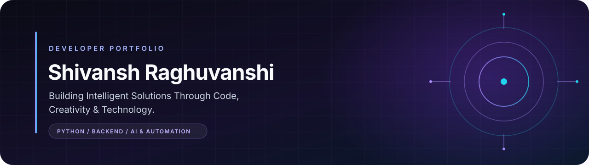

## 01. PREMIUM ANIMATED INTRODUCTION

<strong>Building Intelligent Solutions Through Code, Creativity &amp; Technology.</strong>

## 02. ABOUT ME

I'm a BCA student at Galgotias University, based in India, with a strong interest in software development and emerging technologies. I enjoy turning ideas into practical applications and am especially drawn to Python, backend development, AI, and automation. I keep building, learning, and improving through hands-on projects.

## 03. PROFESSIONAL EXPERIENCE

### Software Development & Testing Intern · [108 IdeaSpace](https://www.108ideaspace.com/)

My internship exposure includes software testing, software development, Python programming, and practical development workflows. It has helped me understand how real-world software projects are developed and tested.

## 04. TECHNICAL SKILLS

Skills below are separated by evidence: the first group appears in my public projects or portfolio; the second group reflects technologies I am learning or exploring, not claims of professional expertise.

| Area | Project-backed technologies |
|---|---|
| Programming | Python, JavaScript, TypeScript, SQL |
| Backend & APIs | FastAPI, REST APIs |
| Frontend | HTML5, CSS3, React |
| Databases | SQLite |
| AI | OpenAI API integration (optional configuration in a public project) |
| Tools | Git, GitHub, VS Code |

  
  
  
  
  

| Area | Learning & exploration |
|---|---|
| Programming | Advanced Python, Java |
| Backend | Backend development, Flask, API development |
| Frontend | React JS |
| Databases | MySQL, MongoDB |
| Data analytics | Pandas, NumPy, Power BI, Tableau |
| AI & automation | Generative AI, AI automation, machine-learning fundamentals |
| Tools & practices | Docker, Linux, PyCharm, WordPress, DevOps, software engineering practices |

## 05. FEATURED PROJECTS

<table>
  <tbody>
    <tr>
      <td>
        <strong>Engineering Portfolio & Interactive Developer Demos</strong> 
        A full-stack portfolio that pairs recruiter-focused information with working engineering examples. It addresses the limits of a static résumé by bringing project data, API-backed views, and safe interactive demos together.  
        <strong>Stack:</strong> React, TypeScript, FastAPI, Python, SQLite 
        <strong>Highlights:</strong> GitHub repository and CI views, optional OpenAI-powered assistant, read-only SQL explorer, and a parameterized-query demo.  
        <a href="https://github.com/Ryoishin/Inventory">Source: Ryoishin/Inventory</a> · No live demo is listed for this repository.
      </td>
    </tr>
    <tr>
      <td>
        <strong>Weather Prediction Model · Prototype</strong> 
        A Python project scaffold for exploring forecasts from historical weather data, with configurable locations, forecast horizons, and output types. The current predictor still contains placeholder training and prediction logic, so no accuracy or live-forecast claims are made.  
        <strong>Stack:</strong> Python 
        <strong>Highlights:</strong> Separate configuration, data-loading, and predictor modules; configurable temperature, humidity, and precipitation outputs.  
        <a href="https://github.com/Ryoishin/WEATHER-PREDICTION-MODEL">View repository</a> · No live demo is listed.
      </td>
    </tr>
    <tr>
      <td>
        <strong>Personal Portfolio Website</strong> 
        A public-facing portfolio for presenting my profile, education, skills, projects, and contact information. It gives recruiters one place to explore my background and current work.  
        <strong>Stack:</strong> HTML, CSS, JavaScript 
        <strong>Highlights:</strong> Profile and project overview, education and skills sections, and a published portfolio site.  
        <a href="https://github.com/Ryoishin/Shivansh">Source repository</a> · <a href="https://shivansh-omega.vercel.app">Live portfolio</a>
      </td>
    </tr>
  </tbody>
</table>

## 06. GITHUB STATISTICS

  

  

  

*These third-party cards use public GitHub activity and may be temporarily unavailable or delayed.*

## 07. CONTRIBUTION ACTIVITY

  

  

  

If the snake is not visible yet, the calendar and activity graph above remain available. The snake appears after the workflow completes its first successful run.

## 08. CURRENTLY LEARNING

- **Python & backend:** strengthening Python fundamentals and exploring backend and API development.
- **Frontend:** building familiarity with React JS.
- **Data analytics:** learning how to work with data using Pandas, NumPy, Power BI, and Tableau.
- **AI & automation:** exploring generative AI, practical automation, and machine-learning fundamentals.
- **Engineering & operations:** developing DevOps knowledge and stronger software engineering practices.

## 09. ACHIEVEMENTS & CERTIFICATIONS

No certifications, awards, competition results, or other achievements with public verification are listed here yet. I’ll add items when I can link to a genuine certificate, result, or contribution.

## 10. WHY WORK WITH ME?

- Practical exposure to software development, testing, Python, and project workflows through an internship.
- Curious about real-world problem-solving and building useful applications.
- Focused on Python, backend development, and AI-enabled application ideas.
- Bring an analytical approach, adaptability, and a continuous-learning mindset.
- Care about clear, maintainable code and improving through feedback.

> I'm interested in internship opportunities, entry-level software development roles, and collaborative projects where I can contribute, learn, and build impactful technology.

## 11. LET'S CONNECT

I'm open to connecting about internships, entry-level opportunities, and collaborative projects.

  
  
  
  

